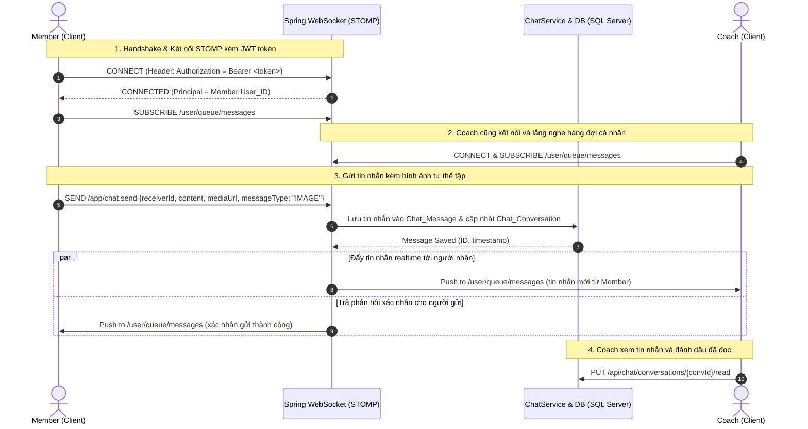

# ĐẶC TẢ TÍCH HỢP TÍNH NĂNG CHATBOX (MEMBER & COACH)
**Dự án**: UNISPORT - SereneDesk Fitness & Sports Center  
**Tài liệu**: Hướng dẫn kỹ thuật & Luồng nghiệp vụ tích hợp Chat Realtime  
**Phiên bản**: 1.0  
**Tác giả**: Đội ngũ phát triển UNISPORT  

---

## 1. TỔNG QUAN & BỐI CẢNH NGHIỆP VỤ (BUSINESS OVERVIEW)

### 1.1. Mục tiêu
Xây dựng tính năng **Chatbox trao đổi 1-1 Realtime** giữa **Hội viên (Member)** và **Huấn luyện viên (Coach)** thuộc nền tảng SereneDesk:
* Giúp Hội viên dễ dàng gửi thắc mắc về lộ trình tập luyện, báo cáo thể trạng sau buổi tập.
* Hỗ trợ Hội viên chụp và gửi **hình ảnh form dáng/tư thế tập luyện tại nhà** (ví dụ: tư thế *plank*, giãn cơ, yoga, nâng tạ) để Huấn luyện viên trực tiếp nhận xét, chỉnh sửa kỹ thuật và phòng tránh chấn thương.
* Giúp Huấn luyện viên chủ động theo dõi tiến độ của học viên, nhắc nhở lịch tập và trao đổi chế độ dinh dưỡng.

---

### 1.2. Phân tích quyền hạn & Phạm vi kết nối (Chat Scope & Rules)

Dựa trên cấu trúc thực tế của hệ thống UNISPORT:
1. **Xác thực danh tính**:
   * Hệ thống Backend xác thực qua JWT Stateless token.
   * `Principal` của Spring Security tương ứng với `User_ID` (chuỗi số nguyên).
   * Thông tin người dùng được lưu trữ ở bảng `[User]` với các vai trò tương ứng trong bảng `Role` (`Member`, `Coach`,...).
2. **Quy tắc mở phiên hội thoại (Conversation Eligibility)**:
   * **Từ phía Member**: Chỉ được phép nhắn tin với các Huấn luyện viên đang trực tiếp phụ trách các lớp học hoặc gói tập mà Member đã đăng ký thành công (dựa trên bảng `Class_Booking` $\rightarrow$ `Class_Session` $\rightarrow$ `Class.Coach_ID` với trạng thái `Booked` / `Active`).
   * **Từ phía Coach**: Chỉ nhận và quản lý tin nhắn từ các học viên đang có tên trong danh sách lớp mình giảng dạy (thừa hưởng logic từ `CoachClassService.getCoachClassDetail()`).
3. **Đặc điểm giao diện (Bám sát thiết kế UI SereneDesk)**:
   * **Giao diện Member Chat**:
     * Danh sách bên trái hiển thị các HLV phụ trách (kèm chức danh/chuyên môn như *HLV Pilates & Phục hồi cơ khớp*, *Yoga Specialist*, *Strength & Conditioning*,...).
     * Hộp thoại bên phải hiển thị lịch sử chat, tin nhắn phân tách theo ngày, bong bóng chat của HLV (nền xám/trắng) và của Member (nền xanh Serene Green `#1b4332`), kèm ảnh chụp bài tập form check.
   * **Giao diện Coach Desk**:
     * Danh sách học viên có gắn thẻ phân loại lớp/gói học (ví dụ: `Gói Pilates 1:1`, `Functional Training`), badge hiển thị số tin nhắn chưa đọc (unread count), xem trước tin nhắn gần nhất.
     * Khung phản hồi học viên chuyên nghiệp, dễ dàng xem ảnh bài tập học viên gửi để gửi lại lời nhận xét kỹ thuật.

---

## 2. THIẾT KẾ CƠ SỞ DỮ LIỆU (DATABASE SCHEMA)

Thực thi kịch bản SQL sau trên cơ sở dữ liệu `swp391_db` (Microsoft SQL Server):

```sql
USE swp391_db;
GO

/* =====================================================================
   1. BẢNG Chat_Conversation (Quản lý phiên trò chuyện 1-1)
   ===================================================================== */
IF OBJECT_ID(N'dbo.Chat_Message', N'U') IS NOT NULL DROP TABLE dbo.Chat_Message;
IF OBJECT_ID(N'dbo.Chat_Conversation', N'U') IS NOT NULL DROP TABLE dbo.Chat_Conversation;
GO

CREATE TABLE Chat_Conversation (
    Conversation_ID INT IDENTITY(1,1) NOT NULL,
    Member_ID       INT               NOT NULL,
    Coach_ID        INT               NOT NULL,
    Class_ID        INT               NULL,         -- Lớp học gắn với bối cảnh trò chuyện (tuỳ chọn)
    Last_Message    NVARCHAR(1000)    NULL,         -- Nội dung tin nhắn cuối (để hiển thị preview ở danh sách)
    Last_Message_At DATETIME2(0)      NOT NULL CONSTRAINT DF_ChatConv_LastAt DEFAULT SYSDATETIME(),
    Created_At      DATETIME2(0)      NOT NULL CONSTRAINT DF_ChatConv_Created DEFAULT SYSDATETIME(),
    CONSTRAINT PK_Chat_Conversation PRIMARY KEY (Conversation_ID),
    CONSTRAINT FK_ChatConv_Member FOREIGN KEY (Member_ID) REFERENCES [User] (User_ID),
    CONSTRAINT FK_ChatConv_Coach  FOREIGN KEY (Coach_ID)  REFERENCES [User] (User_ID),
    CONSTRAINT FK_ChatConv_Class  FOREIGN KEY (Class_ID)  REFERENCES Class (Class_ID),
    CONSTRAINT UQ_Member_Coach UNIQUE (Member_ID, Coach_ID)
);
GO

/* =====================================================================
   2. BẢNG Chat_Message (Lưu trữ chi tiết các tin nhắn)
   ===================================================================== */
CREATE TABLE Chat_Message (
    Message_ID      BIGINT IDENTITY(1,1) NOT NULL,
    Conversation_ID INT                  NOT NULL,
    Sender_ID       INT                  NOT NULL,     -- User_ID người gửi
    Receiver_ID     INT                  NOT NULL,     -- User_ID người nhận
    Content         NVARCHAR(MAX)        NULL,         -- Nội dung văn bản
    Message_Type    NVARCHAR(20)         NOT NULL CONSTRAINT DF_ChatMsg_Type DEFAULT N'TEXT', -- 'TEXT', 'IMAGE'
    Media_URL       VARCHAR(500)         NULL,         -- Đường dẫn hình ảnh khi gửi form tập
    Is_Read         BIT                  NOT NULL CONSTRAINT DF_ChatMsg_IsRead DEFAULT 0,
    Created_At      DATETIME2(0)         NOT NULL CONSTRAINT DF_ChatMsg_Created DEFAULT SYSDATETIME(),
    CONSTRAINT PK_Chat_Message PRIMARY KEY (Message_ID),
    CONSTRAINT FK_ChatMsg_Conversation FOREIGN KEY (Conversation_ID) REFERENCES Chat_Conversation (Conversation_ID),
    CONSTRAINT FK_ChatMsg_Sender   FOREIGN KEY (Sender_ID)   REFERENCES [User] (User_ID),
    CONSTRAINT FK_ChatMsg_Receiver FOREIGN KEY (Receiver_ID) REFERENCES [User] (User_ID),
    CONSTRAINT CK_ChatMsg_Type CHECK (Message_Type IN (N'TEXT', N'IMAGE', N'SYSTEM'))
);
GO

/* =====================================================================
   3. TẠO INDEXES TỐI ƯU TRUY VẤN
   ===================================================================== */
CREATE INDEX IX_ChatConv_Member ON Chat_Conversation (Member_ID, Last_Message_At DESC);
CREATE INDEX IX_ChatConv_Coach  ON Chat_Conversation (Coach_ID, Last_Message_At DESC);
CREATE INDEX IX_ChatMsg_Conv_Created ON Chat_Message (Conversation_ID, Created_At ASC);
CREATE INDEX IX_ChatMsg_Receiver_Unread ON Chat_Message (Receiver_ID, Is_Read) WHERE Is_Read = 0;
GO
```

---

## 3. KIẾN TRÚC KỸ THUẬT & LUỒNG XỬ LÝ REALTIME



---

## 4. CHI TIẾT CÁC THÀNH PHẦN BACKEND (SPRING BOOT)

### 4.1. Thêm Thư viện WebSocket vào `pom.xml`
Bổ sung starter websocket vào `BE-SWP/pom.xml`:
```xml
<dependency>
    <groupId>org.springframework.boot</groupId>
    <artifactId>spring-boot-starter-websocket</artifactId>
</dependency>
```

### 4.2. Cấu hình WebSocket Broker & Xác thực Token (`WebSocketConfig.java`)
* Endpoint kết nối: `/ws`
* Cho phép CORS với `http://localhost:5173`
* Bắt token tại bước STOMP connect để nạp danh tính người dùng vào WebSocket Session:

```java
package com.swp391.beswp.config;

import com.swp391.beswp.service.JwtService;
import lombok.RequiredArgsConstructor;
import org.springframework.context.annotation.Configuration;
import org.springframework.messaging.Message;
import org.springframework.messaging.MessageChannel;
import org.springframework.messaging.simp.config.ChannelRegistration;
import org.springframework.messaging.simp.config.MessageBrokerRegistry;
import org.springframework.messaging.simp.stomp.StompCommand;
import org.springframework.messaging.simp.stomp.StompHeaderAccessor;
import org.springframework.messaging.support.ChannelInterceptor;
import org.springframework.messaging.support.MessageHeaderAccessor;
import org.springframework.security.authentication.UsernamePasswordAuthenticationToken;
import org.springframework.web.socket.config.annotation.EnableWebSocketMessageBroker;
import org.springframework.web.socket.config.annotation.StompEndpointRegistry;
import org.springframework.web.socket.config.annotation.WebSocketMessageBrokerConfigurer;

import java.util.List;
import java.util.Map;

@Configuration
@EnableWebSocketMessageBroker
@RequiredArgsConstructor
public class WebSocketConfig implements WebSocketMessageBrokerConfigurer {

    private final JwtService jwtService;

    @Override
    public void configureMessageBroker(MessageBrokerRegistry registry) {
        // Prefix cho các message gửi từ server về client:
        registry.enableSimpleBroker("/topic", "/queue");
        // Prefix cho các message client gửi lên server:
        registry.setApplicationDestinationPrefixes("/app");
        // Đích riêng cho từng user:
        registry.setUserDestinationPrefix("/user");
    }

    @Override
    public void registerStompEndpoints(StompEndpointRegistry registry) {
        registry.addEndpoint("/ws")
                .setAllowedOriginPatterns("http://localhost:5173")
                .withSockJS();
    }

    @Override
    public void configureClientInboundChannel(ChannelRegistration registration) {
        registration.interceptors(new ChannelInterceptor() {
            @Override
            public Message<?> preSend(Message<?> message, MessageChannel channel) {
                StompHeaderAccessor accessor =
                        MessageHeaderAccessor.getAccessor(message, StompHeaderAccessor.class);
                if (accessor != null && StompCommand.CONNECT.equals(accessor.getCommand())) {
                    String authHeader = accessor.getFirstNativeHeader("Authorization");
                    if (authHeader != null && authHeader.startsWith("Bearer ")) {
                        String token = authHeader.substring(7);
                        try {
                            Map<String, Object> claims = jwtService.validateToken(token);
                            String userId = String.valueOf(claims.get("sub"));
                            UsernamePasswordAuthenticationToken auth =
                                    new UsernamePasswordAuthenticationToken(userId, null, List.of());
                            accessor.setUser(auth);
                        } catch (Exception ignored) {
                            // Token không hợp lệ
                        }
                    }
                }
                return message;
            }
        });
    }
}
```

### 4.3. Các Thực thể JPA (Entities)
1. `ChatConversation.java`:
   * Các trường: `id`, `User member`, `User coach`, `ClassEntity classEntity`, `lastMessage`, `lastMessageAt`, `createdAt`.
2. `ChatMessage.java`:
   * Các trường: `id`, `ChatConversation conversation`, `User sender`, `User receiver`, `content`, `messageType`, `mediaUrl`, `isRead`, `createdAt`.

### 4.4. Các Endpoint REST API Bổ trợ (`ChatRestController.java`)
Đường dẫn gốc: `/api/chat`
* `GET /api/chat/contacts`:
  * Trả về danh sách đối tác chat phù hợp với Role của tài khoản hiện tại:
    * Nếu là Member: Trả về danh sách các HLV của lớp mình học (kèm tên, avatar, chuyên môn bộ môn, tin nhắn cuối, unreadCount).
    * Nếu là Coach: Trả về danh sách học viên trong các lớp mình dạy (kèm tên, avatar, tên lớp/gói học, tin nhắn cuối, unreadCount).
* `GET /api/chat/conversations/{conversationId}/messages`:
  * Lấy lịch sử tin nhắn của cuộc hội thoại (hỗ trợ phân trang `page`, `size`).
* `PUT /api/chat/conversations/{conversationId}/read`:
  * Đánh dấu các tin nhắn gửi đến mình trong cuộc trò chuyện này là đã đọc (`isRead = true`).
* `POST /api/chat/upload-image`:
  * Nhận `MultipartFile` hình ảnh tư thế form tập, lưu trữ vào thư mục `uploads/chat/` (tương tự `AvatarService`), trả về đường dẫn URL công khai (ví dụ: `/uploads/chat/uuid.jpg`).

### 4.5. Bộ xử lý tin nhắn WebSocket Controller (`ChatWebSocketController.java`)
```java
@Controller
@RequiredArgsConstructor
public class ChatWebSocketController {

    private final ChatService chatService;
    private final SimpMessagingTemplate messagingTemplate;

    @MessageMapping("/chat.send")
    public void sendMessage(
            @Payload ChatSendRequest request,
            Authentication authentication
    ) {
        String senderId = authentication.getName();
        ChatMessageResponse response = chatService.saveMessage(senderId, request);

        // Gửi tới người nhận:
        messagingTemplate.convertAndSendToUser(
                String.valueOf(request.getReceiverId()),
                "/queue/messages",
                response
        );

        // Phản hồi lại cho người gửi (để cập nhật UI ngay lập tức):
        messagingTemplate.convertAndSendToUser(
                senderId,
                "/queue/messages",
                response
        );
    }
}
```

---

## 5. THIẾT KẾ & TÍCH HỢP FRONTEND (FE-SWP)

### 5.1. Cài đặt Thư viện
Mở terminal tại thư mục `FE-SWP`:
```bash
npm install @stomp/stompjs sockjs-client
```

### 5.2. Hook kết nối WebSocket STOMP (`src/hooks/useChatSocket.js`)
```javascript
import { useEffect, useRef, useState, useCallback } from 'react'
import { Client } from '@stomp/stompjs'
import SockJS from 'sockjs-client'
import { getAccessToken } from '../auth/authStorage'

export function useChatSocket(onMessageReceived) {
  const stompClientRef = useRef(null)
  const [connected, setConnected] = useState(false)

  useEffect(() => {
    const token = getAccessToken()
    if (!token) return

    const client = new Client({
      webSocketFactory: () => new SockJS('http://localhost:8080/ws'),
      connectHeaders: {
        Authorization: `Bearer ${token}`,
      },
      debug: () => {},
      reconnectDelay: 5000,
      heartbeatIncoming: 4000,
      heartbeatOutgoing: 4000,
      onConnect: () => {
        setConnected(true)
        client.subscribe('/user/queue/messages', (message) => {
          if (message.body) {
            const data = JSON.parse(message.body)
            onMessageReceived?.(data)
          }
        })
      },
      onDisconnect: () => {
        setConnected(false)
      },
    })

    client.activate()
    stompClientRef.current = client

    return () => {
      client.deactivate()
    }
  }, [onMessageReceived])

  const sendMessage = useCallback((receiverId, content, messageType = 'TEXT', mediaUrl = null) => {
    if (stompClientRef.current && stompClientRef.current.connected) {
      stompClientRef.current.publish({
        destination: '/app/chat.send',
        body: JSON.stringify({
          receiverId,
          content,
          messageType,
          mediaUrl,
        }),
      })
    }
  }, [])

  return { connected, sendMessage }
}
```

### 5.3. Xây dựng Cấu trúc Component Chat
Tạo mới thư mục `FE-SWP/src/pages/chat/` bao gồm:
1. `ChatWorkspace.jsx` (Giao diện chuẩn chia 2 khung chính):
   * Khung trái (`chat-sidebar-column`):
     * Thanh tìm kiếm ("Tìm kiếm huấn luyện viên..." / "Tìm kiếm học viên...").
     * Danh sách bạn chat: Avatar tròn có chấm online, Tên hiển thị, Chuyên môn / Tên gói tập (badge màu xanh nhạt), Đoạn text tin nhắn cuối cùng, Giờ gửi, Badge đỏ/xanh thông báo số tin nhắn chưa đọc.
   * Khung phải (`chat-main-column`):
     * **Header**: Avatar bạn chat, Tên, Chuyên môn/Lớp, Trạng thái hoạt động.
     * **Message Feed**:
       * Nhóm tin nhắn theo ngày (`Hôm nay, 24 Tháng 10, 2024`).
       * Bong bóng chat bên trái (HLV/Học viên): màu trắng viền xám nhạt, bo góc mềm mại.
       * Bong bóng chat bên phải (Bạn): màu Serene Dark Green (`#1b4332`), chữ trắng.
       * Thẻ hình ảnh bài tập: Khung xem ảnh bo tròn, có nhãn "Form check" và chú thích bên dưới ảnh như mockup ("*Tư thế plank và giãn lưng sáng nay*").
     * **Input Bar**:
       * Nút kẹp ghim / đính kèm hình ảnh (mở hộp thoại chọn ảnh chụp bài tập).
       * Nút emoji.
       * Ô nhập văn bản ("*Nhập tin nhắn cho huấn luyện viên...*" / "*Soạn tin nhắn phản hồi học viên...*").
       * Nút **Gửi** màu xanh đậm kèm icon mũi tên gửi.

### 5.4. Cập nhật Router và Menu Hệ thống

1. **Thêm vào `FE-SWP/src/App.jsx`**:
```jsx
// Import component:
import MemberChat from './pages/MemberChat'
import CoachChat from './pages/CoachChat'

// Trong thẻ <Routes>:
<Route
  path="/member/chat"
  element={
    <ProtectedRoute allowedRoles={[ROLES.MEMBER]}>
      <MemberChat />
    </ProtectedRoute>
  }
/>
<Route
  path="/coach/chat"
  element={
    <ProtectedRoute allowedRoles={[ROLES.COACH]}>
      <CoachChat />
    </ProtectedRoute>
  }
/>
```

2. **Cập nhật menu Sidebar**:
* Trong `FE-SWP/src/components/memberMenuItems.js`:
  ```javascript
  { icon: 'chat', label: 'Trao đổi HLV', route: '/member/chat' }
  ```
* Trong `FE-SWP/src/components/coachMenuItems.js`:
  ```javascript
  { icon: 'forum', label: 'Tin nhắn học viên', route: '/coach/chat' }
  ```

---

## 6. KỊCH BẢN KIỂM THỬ (TESTING CHECKLIST)

Sau khi hoàn thành tích hợp, thực hiện kiểm thử theo các kịch bản sau:

| STT | Kịch bản kiểm thử | Kết quả mong đợi |
| :--- | :--- | :--- |
| **TC-01** | **Xác thực kết nối WebSocket** | Kết nối tới `/ws` thành công với token hợp lệ; nếu không truyền token hoặc token sai sẽ bị từ chối kết nối. |
| **TC-02** | **Hiển thị danh bạ chính xác** | Member A chỉ nhìn thấy các HLV của các lớp Member A đã đặt chỗ thành công. HLV chỉ thấy các học viên trong lớp mình phụ trách. |
| **TC-03** | **Gửi & Nhận tin nhắn Text tức thì** | Mở 2 cửa sổ ẩn danh (1 Member, 1 Coach). Member gửi text, Coach nhận được ngay lập tức trên màn hình mà không cần F5. |
| **TC-04** | **Gửi hình ảnh Form check bài tập** | Member bấm biểu tượng đính kèm ảnh, chọn ảnh tư thế tập gym/yoga; ảnh được upload lên server và tin nhắn dạng `IMAGE` hiển thị rõ nét trên màn hình cả 2 bên. |
| **TC-05** | **Đánh dấu đã đọc (Unread badge)** | Khi có tin nhắn mới, badge số lượng tin chưa đọc tăng lên ở danh sách bên trái; khi bấm vào cuộc trò chuyện, gọi API `/read` và badge biến mất. |
| **TC-06** | **Tải lại lịch sử chat (Persistence)** | F5 lại trang, cuộc hội thoại vẫn lưu giữ đầy đủ các tin nhắn cũ theo đúng thứ tự thời gian. |

---
*Tài liệu này đóng vai trò là kim chỉ nam kỹ thuật chuẩn xác, hỗ trợ nhóm phát triển triển khai tính năng Chat một cách an toàn và tối ưu nhất trên nền tảng UNISPORT.*
